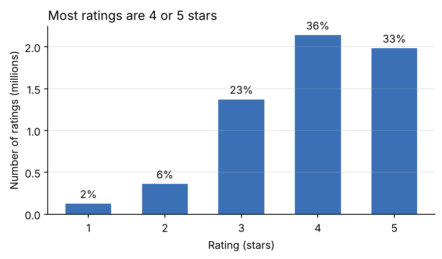
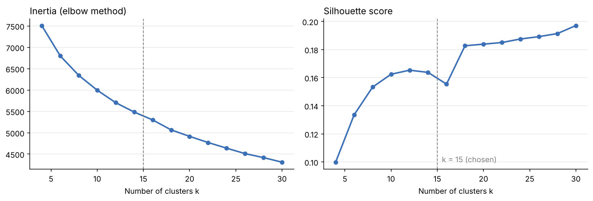

# Book Recommender

A book recommendation system built in Python on the [Goodbooks-10k](https://github.com/zygmuntz/goodbooks-10k) dataset (10,000 books, ~6 million ratings). It builds four recommenders (popularity, content-based, k-means clustering, item-based collaborative filtering) and compares them with an offline evaluation protocol.

**Main result**: on 5,000 test readers, item-based collaborative filtering recommends books the reader actually liked in **32.5%** of cases (precision@10), against 21.4% for the content-based model and 7.7% for popularity.


**Example**: books recommended for *Pride and Prejudice*, using k-means clusters and excluding books by the same author:

| Rank | Book | Author | Cosine similarity |
| --- | --- | --- | --- |
| 1 | Wuthering Heights | Emily Brontë | 0.951 |
| 2 | North and South | Elizabeth Gaskell | 0.927 |
| 3 | Tess of the D'Urbervilles | Thomas Hardy | 0.917 |
| 4 | A Tale of Two Cities / Great Expectations | Charles Dickens | 0.912 |
| 5 | Wives and Daughters | Elizabeth Gaskell | 0.908 |

## Highlights

- **Exploratory analysis** of ~6M ratings: a 99% sparse user × book matrix, a long-tail popularity distribution, and noisy user-generated tags.
- **Popularity baseline** using a weighted rating (IMDb-style) to avoid favouring books with only a few ratings.
- **Content-based recommender**: TF-IDF on authors and Goodreads tags, cosine similarity (equivalent to a k-nearest-neighbours search).
- **k-means clustering**: tag cleaning, TF-IDF, truncated SVD (LSA), choice of k with the elbow method and the silhouette score. The 15 clusters match recognisable genres (classics, crime, epic fantasy, young adult, comics…) without the model ever being given a genre.
- **Item-based collaborative filtering** on the ratings, with sparse nearest-neighbour similarity matrices.
- **Offline evaluation**: per-user train/test split, precision@10, recall@10 and catalogue coverage, hyperparameters tuned on separate validation users, no data leakage.

## Dataset

[Goodbooks-10k](https://github.com/zygmuntz/goodbooks-10k), by Zygmunt Zając, built from Goodreads data:

| File | Content |
| --- | --- |
| `books.csv` | metadata for 10,000 books |
| `ratings.csv` | 5,976,479 ratings (1–5 stars) from 53,424 users |
| `book_tags.csv` | number of times each tag was applied to each book |
| `tags.csv` | tag names (34,252 tags) |

The data is not stored in this repository. Download it with `./download_data.sh` (see below).

## Methods and results

### 1. Exploratory analysis — [`01_exploration.ipynb`](notebooks/01_exploration.ipynb)



- 69% of ratings are 4 or 5 stars (mean 3.92).
- Only 1.1% of the user × book matrix is filled.
- The 10% most-rated books receive 53% of all ratings.
- The most frequent tags (`to-read`, `favorites`, `owned`…) describe the reader's shelf, not the book: they must be removed before using tags as features.

### 2. Baselines — [`02_popularity_and_content_based.ipynb`](notebooks/02_popularity_and_content_based.ipynb)

- **Popularity**: ranking by weighted rating. Not personalised; the top 10 is dominated by *Harry Potter*.
- **Content-based**: each book becomes a TF-IDF vector of its authors and 20 most frequent tags; recommendations are the books with the highest cosine similarity. The author weighs heavily, so results are first filled with the same author's books; an option to exclude them makes the results more diverse.

### 3. k-means clustering — [`03_kmeans_clustering.ipynb`](notebooks/03_kmeans_clustering.ipynb)

Pipeline: tag cleaning (34,252 → 2,633 tags) → book × tag matrix with `log(1 + count)` and TF-IDF → truncated SVD to 100 dimensions → L2 normalisation (so that Euclidean k-means groups books by cosine similarity) → k-means.



Neither the elbow method nor the silhouette score shows a clear optimum, which is expected when genres overlap. k = 15 was chosen because it gives interpretable, balanced clusters (347 to 1,015 books each):

| Cluster | Top tags | Most-rated books |
| --- | --- | --- |
| Classics | classics, classic-literature | To Kill a Mockingbird, The Great Gatsby |
| Crime | mystery, crime, thriller | Angels & Demons, The Girl with the Dragon Tattoo |
| Epic fantasy | epic-fantasy, high-fantasy | The Hobbit, A Game of Thrones |
| Young adult (speculative) | ya, young-adult, fantasy | The Hunger Games, Divergent |
| Young adult (realistic) | ya-contemporary, realistic-fiction | The Fault in Our Stars, Looking for Alaska |
| Paranormal romance | vampires, paranormal-romance | Twilight, City of Bones |
| Comics | comics, comic-books, manga | Watchmen, V for Vendetta |

*7 of the 15 clusters shown; the full table is in the notebook.*

Recommendations are then made within the book's cluster, ranked by cosine similarity (example at the top of this page).

### 4. Collaborative filtering and evaluation — [`04_collaborative_filtering_and_evaluation.ipynb`](notebooks/04_collaborative_filtering_and_evaluation.ipynb)

**Protocol**: a book is "liked" if rated 4 or 5 stars. For every reader, 20% of their liked books are hidden (test set); models only see the remaining ratings and recommend 10 unseen books. The number of neighbours *k* of each model is tuned on 5,000 validation readers, and final scores are computed on 5,000 different test readers.

**Item-based collaborative filtering**: two books are similar when the same readers liked them (cosine similarity on the user × book matrix). Each book keeps its *k* = 5 closest neighbours, and a reader's score for a book is the sum of its similarities with the books they liked. The content-based and k-means models are evaluated with the same scoring, only the similarity changes.

| Model | Precision@10 | Recall@10 | Catalogue coverage |
| --- | --- | --- | --- |
| Random | 0.2% | 0.1% | 99% |
| Popularity | 7.7% | 5.1% | 0.4% |
| k-means | 20.4% | 13.7% | 76% |
| Content-based | 21.4% | 14.5% | 65% |
| **Item-based CF** | **32.5%** | **21.8%** | 53% |

- Ratings carry information that metadata does not: who reads what together.
- Popularity is a weak baseline here: readers of this dataset have already rated most bestsellers, and it recommends the same 40 books to everyone.
- Precision values are underestimates (an unread book is not necessarily a bad recommendation); they are meant for comparing models.

## Project structure

```
book_recommender/
├── data/                  # dataset, downloaded by download_data.sh (not versioned)
├── figures/               # charts exported by the notebooks
├── notebooks/
│   ├── 01_exploration.ipynb
│   ├── 02_popularity_and_content_based.ipynb
│   ├── 03_kmeans_clustering.ipynb
│   └── 04_collaborative_filtering_and_evaluation.ipynb
├── download_data.sh
├── requirements.txt
└── README.md
```

## Getting started

```bash
git clone https://github.com/maayouch/book_recommender.git
cd book_recommender

# create an environment (conda or venv) with Python 3.11+
conda create -n bookrec python=3.11
conda activate bookrec
pip install -r requirements.txt

# download the dataset (~90 MB) into data/
./download_data.sh

# open the notebooks
jupyter notebook notebooks/
```

Run the notebooks in order. Results are reproducible (`random_state = 42`). Tested with Python 3.13, pandas 3.0, scikit-learn 1.9.


## Author

Maryem Ayouch — engineering student at ENSEIRB-MATMECA (Bordeaux, France).